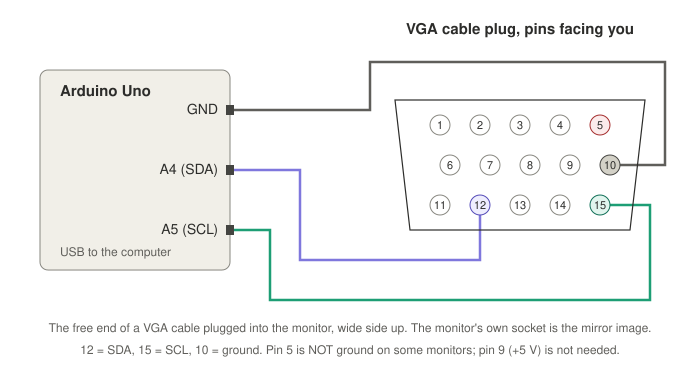

# rtd-ddc-flash

Read, back up and patch the firmware of a monitor with a Realtek RTD2281
scaler through its VGA input, using an Arduino Uno and three wires. The
monitor stays closed and nothing is soldered.

It was made to add a 1280x1024 @ 50 Hz input mode to an Acer B196L, so the
monitor shows the 50 Hz VGA output of the Vector-06C ComboLite board. The
same steps should work for other RTD2281 monitors and, with the original
tools listed in Credits, for the RTD266x family.

[Русская версия](README.ru.md)

**Status.** Tested on an Acer B196L (6 Nov 2026): `scan`, `info`, `verify`
of the whole 256 KB flash (65 s), and `write` of a test pattern into a blank
sector and back, with the write protection restored. The Q50 patch itself
was flashed with an earlier, modified RTD266xFlash sketch.

## What you need

- the monitor, powered on, with its VGA input free (no computer on it);
- an Arduino Uno (R3 or a 5 V clone);
- three jumper wires, or an old VGA cable / VGA breakout to tap into;
- a computer with Python 3 and `pyserial`, plus `arduino-cli` or the Arduino IDE.

## Wiring



| Uno | VGA pin | signal |
|---|---|---|
| A4 | 12 | SDA (DDC data) |
| A5 | 15 | SCL (DDC clock) |
| GND | 10 | ground |

- Use pin 10 for ground. On the B196L pin 5 is not connected inside the
  monitor, and with ground there the bus sat at ~1 V and nothing answered.
- No pull-up resistors and no +5 V on pin 9: the monitor has its own.
- Jumper wires fit into the monitor's socket directly. If you tap a cable's
  plug instead, its numbering is mirrored.

## Steps

```sh
python3 -m pip install pyserial
arduino-cli core install arduino:avr
arduino-cli compile -b arduino:avr:uno arduino/rtdddc
arduino-cli upload  -b arduino:avr:uno -p PORT arduino/rtdddc
```

PORT is `/dev/cu.usbmodem*` on macOS, `/dev/ttyACM0` on Linux, `COMx` on
Windows. The Arduino IDE works too: open `arduino/rtdddc/rtdddc.ino`.

1. **Check the bus.** Both lines must sit near 5 V and the scaler must answer at 0x4A.

   ```sh
   python3 tools/rtdddc.py PORT scan
   # SDA 4.57 V, SCL 4.56 V ...
   # I2C devices: 0x37 0x4A 0x4B 0x50
   ```

2. **Identify the flash.** This stops the monitor's CPU (the screen may freeze or go dark).

   ```sh
   python3 tools/rtdddc.py PORT info
   # flash JEDEC C22012, 256 KB, status 0C
   ```

3. **Back up.** The tool reads the flash twice and saves only if both reads
   match. Keep this file: it is the way back.

   ```sh
   python3 tools/rtdddc.py PORT dump backup.bin
   ```

4. **Patch the mode table.**

   ```sh
   python3 tools/modetable.py list backup.bin
   python3 tools/modetable.py preset q50 backup.bin patched.bin
   # or any mode: modetable.py add backup.bin patched.bin --mode W H HFREQ VFREQ HTOTAL VTOTAL HSTART VSTART
   ```

   The new record overwrites the 1152x870@75 Mac mode by default
   (`--replace` picks another). The tool refuses if a matching mode is
   already in the table.

5. **Write.** Only the 4 KB sectors that differ are erased and programmed;
   each is read back and checked. Flash write protection is lifted for the
   duration and restored afterwards.

   ```sh
   python3 tools/rtdddc.py PORT write patched.bin
   ```

6. Disconnect the Uno, unplug the monitor's mains cable for ~10 s, then feed
   it the new mode. If the picture looks soft, press the monitor's Auto
   button; on a picture with a dark border it may take several presses.

To undo: `rtdddc.py PORT write backup.bin`. ISP mode is handled by the
scaler hardware, not by its firmware, so the backup should go back even if
the patched firmware does not start (not tested).

## Acer B196L

See [patches/acer-b196l-q50.md](patches/acer-b196l-q50.md): firmware
checksums before and after, the exact 15 bytes, and photos. The firmware
images themselves are not published (they belong to Acer). Dump your own
and patch it.

## Notes on RTD2281

Found on the B196L; not mentioned by the RTD266x tools:

- The first byte read from data port 0x70 after starting a flash read is
  stale (left over from the previous transfer). The sketch re-reads it with
  a one-byte READ command.
- With that fixed, the scaler's CRC engine (registers 0x72-0x75: CRC-8,
  polynomial 0x07) matches the data, and `rtdddc.py` checks every read and
  every programmed page against it. With the RTD266x sketch every read
  failed this check on the B196L; the stale first byte was the cause.
- The B196L has a 2 Mbit Macronix MX25L2005 with block protection on
  (status 0C). It must be cleared before erasing; `write` handles that.
- The mode table is not covered by any checksum: a monitor with a heavily
  edited table boots and uses it.

The sketch speaks a small framed binary protocol (see the header of
`arduino/rtdddc/rtdddc.ino`). `tools/rtdddc.py` is the only host program.

## Credits

The scaler register map comes from
[ghent360/RTD-2660-Programmer](https://github.com/ghent360/RTD-2660-Programmer),
[adafruit/Adafruit_RTD266X_I2CFlasher](https://github.com/adafruit/Adafruit_RTD266X_I2CFlasher)
and [floppes/RTD266xFlash](https://github.com/floppes/RTD266xFlash). The code
here is written from scratch.

## Warning

Writing monitor firmware can leave the monitor unable to start. Keep the
backup. As long as the scaler answers at 0x4A, the same three wires can put
the backup back.

## License

MIT, see [LICENSE](LICENSE).
