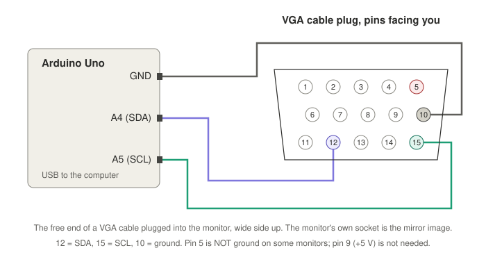

# rtd-ddc-flash

Чтение, резервная копия и правка прошивки монитора на скалере Realtek
RTD2281 через его вход VGA: Arduino Uno и три провода. Монитор не
разбирается, паять ничего не нужно.

Сделано, чтобы добавить в Acer B196L режим 1280x1024 50 Гц и показывать на
нём VGA платы ComboLite для «Вектора-06Ц» без пропусков кадров.

[English](README.md)

**Состояние.** B196L читался и прошивался доработанным скетчем RTD266xFlash;
`arduino/rtdddc` -- переписанный с нуля скетч, на мониторе ещё не запускался.
`tools/modetable.py` проверен на настоящих дампах.

## Что нужно

- монитор, включённый, вход VGA свободен (компьютер от него отключить);
- Arduino Uno (R3 или клон на 5 В);
- три провода-перемычки, или старый VGA-кабель / переходник с клеммами;
- компьютер с Python 3 и `pyserial`, плюс `arduino-cli` или Arduino IDE.

## Подключение



| Uno | VGA | сигнал |
|---|---|---|
| A4 | 12 | SDA |
| A5 | 15 | SCL |
| GND | 10 | земля |

- Землю брать с 10-го контакта. У B196L 5-й контакт внутри никуда не
  подключён: с землёй на нём линии висели на ~1 В и никто не отвечал.
- Подтяжки и +5 В на 9-й контакт не нужны, в мониторе свои.
- Перемычки втыкаются прямо в гнездо монитора. На штекере кабеля нумерация
  зеркальная.

## Шаги

```sh
python3 -m pip install pyserial
arduino-cli core install arduino:avr
arduino-cli compile -b arduino:avr:uno arduino/rtdddc
arduino-cli upload  -b arduino:avr:uno -p ПОРТ arduino/rtdddc
```

1. `python3 tools/rtdddc.py ПОРТ scan` -- обе линии около 5 В, среди адресов есть 0x4A.
2. `python3 tools/rtdddc.py ПОРТ info` -- тип флешки. Процессор монитора при этом останавливается.
3. `python3 tools/rtdddc.py ПОРТ dump backup.bin` -- читает флешку дважды и сохраняет, только если чтения совпали. Этот файл беречь.
4. `python3 tools/modetable.py preset q50 backup.bin patched.bin` -- режим Q50 вместо 1152x870@75. Любой другой режим: `modetable.py add ... --mode W H HFREQ VFREQ HTOTAL VTOTAL HSTART VSTART`.
5. `python3 tools/rtdddc.py ПОРТ write patched.bin` -- переписывает только отличающиеся сектора по 4 КБ, каждый проверяет чтением; защиту записи снимает на время и возвращает.
6. Отключить Uno, выдернуть сетевой шнур монитора секунд на десять, подать новый режим. Если точки мутные -- нажать Auto; на картинке с тёмным бордюром иногда не с первого раза.

Вернуть как было: `rtdddc.py ПОРТ write backup.bin`.

Подробности по B196L и что именно поменялось -- [patches/acer-b196l-q50.md](patches/acer-b196l-q50.md).
Сами образы прошивки не выкладываются, они принадлежат Acer: снимите свой дамп и пропатчьте его.
